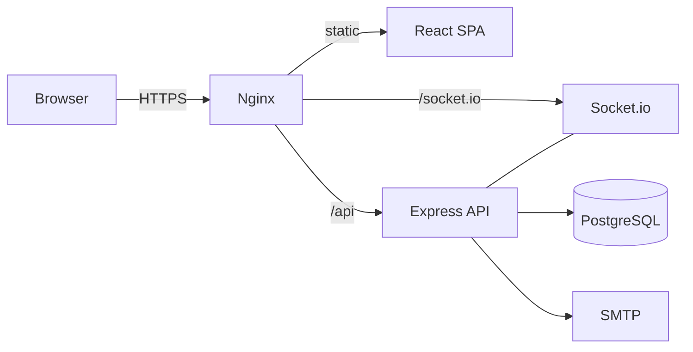
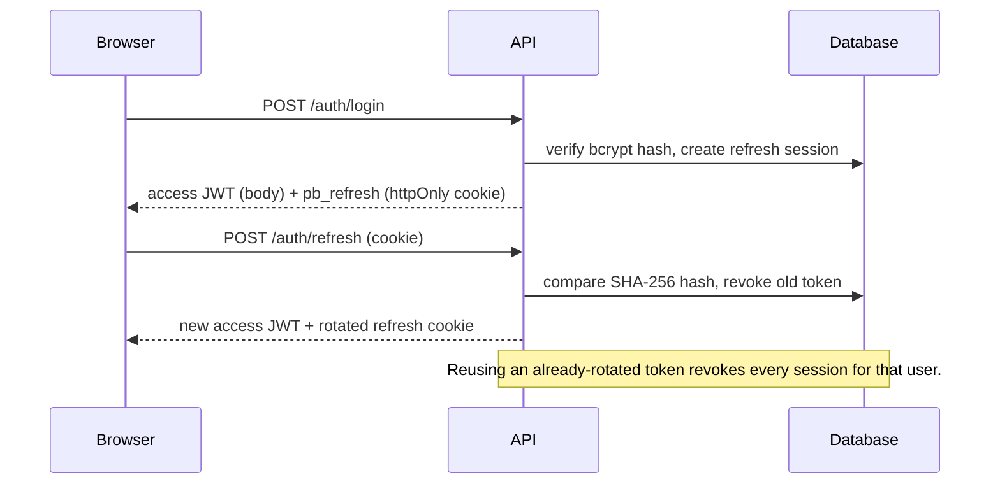
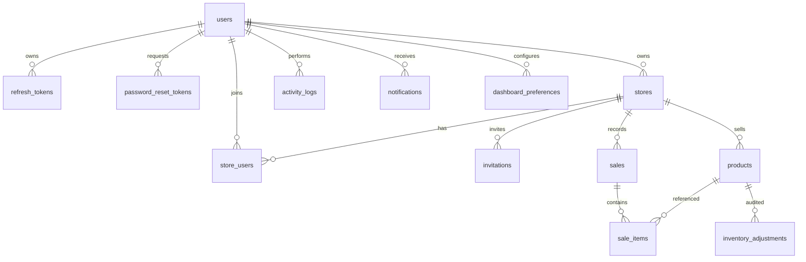

# Architecture

PulseBoard is a two-workspace TypeScript monorepo: an Express API and a React single-page
client. Development uses an embedded PostgreSQL-compatible engine (PGlite); production uses
PostgreSQL and Nginx.

## System context



The browser never talks to PostgreSQL. Nginx serves the built client, proxies API calls and
upgrades WebSocket connections.

## Frontend

| Concern | Implementation |
| --- | --- |
| Routing | `react-router-dom` v7, lazy-loaded route modules, auth and permission guards |
| Server state | TanStack Query with typed hooks and query-key factories |
| Local state | Zustand stores for authentication, UI/theme and toasts |
| Forms | React Hook Form + Zod resolvers, server field errors mapped back to inputs |
| Charts | Recharts with theme-aware tooltips and empty states |
| Realtime | `useSocketBridge` joins the active store and invalidates affected queries |
| Styling | Tailwind CSS with semantic tokens, dark mode via a `dark` class |

### Route protection

1. `RequireAuth` waits for the boot splash while `/auth/refresh` runs.
2. Guests are redirected to `/login` with the attempted path in router state.
3. `RequirePermission` resolves the active store role and renders an access notice when the
   role lacks the permission.
4. The server independently enforces the same permission on every request.

Hiding a button is a UX decision; it is never the security boundary.

### Session bootstrap

```
App boot → POST /auth/refresh (httpOnly cookie)
        → access token kept in memory
        → GET /auth/me (profile, stores, preferences)
        → theme applied, active store restored from localStorage
```

If the refresh cookie is missing or invalid, the app becomes a guest without showing an
error. A 401 during normal operation triggers a single-flight refresh and retries the
original request once.

### Localisation

The interface ships in English, German and Uzbek (Latin). English source strings are the
translation keys, so there is no separate key namespace to maintain:

```tsx
<span>{t('Today’s revenue')}</span>
```

- `apps/web/src/lib/i18n.ts` owns the current language, `t()`, `intlLocale()`, `htmlLang()`,
  first-visit detection and the global Zod error map.
- `apps/web/src/lib/translations/de.ts` and `uz.ts` are typed dictionaries keyed by the
  English source string. Missing keys fall back to English rather than rendering a raw key.
- `applyLanguage()` updates `<html lang>`, the Zod error map and the document title, and is
  called on rehydration so a refresh never flashes English copy.
- Uzbek number, currency, date and relative-time formatting lives in
  `apps/web/src/lib/utils.ts`; browser ICU data for Latin Uzbek is inconsistent, so the app
  does not rely on it.
- The language is persisted in the UI store and in the user's profile. The topbar and the
  auth pages share the same `LanguageMenu`, so visitors can switch before signing in.

Translation tooling (not part of the runtime):

```bash
node scripts/collect-i18n-keys.cjs        # scan 74 files, write keys.json
node scripts/generate-translations.cjs    # rebuild de.ts / uz.ts
node scripts/scan-untranslated.cjs        # audit for hardcoded JSX copy
```

Curated wording lives in `scripts/i18n-curated.cjs` and `scripts/i18n-corrections.cjs`; they
override the machine-generated fallback and are the right place to fix tone or terminology.
Add new UI copy as a literal English string inside `t('…')` and re-run the first two scripts.

## Backend

```
src/index.ts       process lifecycle, migrations, sockets, graceful shutdown
src/app.ts         middleware pipeline, routers, health, OpenAPI, errors
modules/<domain>   routes → Zod validation → service → Drizzle
middleware/        request id, auth, store RBAC, rate limits, error mapping
lib/               jwt, password, money, csv, cache, mailer, notifications
realtime/          Socket.io server and event bus
db/                schema, migration runner, seed
```

### Request pipeline

1. `requestId` attaches or generates `X-Request-Id`.
2. `helmet`, CORS allow-list, compression, body limits and cookies.
3. Pino HTTP logging with redaction of cookies, tokens and passwords.
4. Global API rate limiter.
5. Route-level authentication.
6. Store-scoped permission middleware (membership, owner, role).
7. Zod validation of body, query and params.
8. Service layer performs the database work inside Drizzle.
9. Success is wrapped as `{ data, meta? }`; failures become `{ error: { ... } }`.
10. Errors are mapped to stable codes (`VALIDATION_ERROR`, `UNAUTHORIZED`, `FORBIDDEN`,
    `NOT_FOUND`, `CONFLICT`, `RATE_LIMITED`) with the request ID.

### Authentication and refresh rotation



- Access tokens are valid for 15 minutes and are never written to storage.
- Refresh tokens are random 256-bit values; only a hash is stored.
- Cookies are `httpOnly`, `SameSite=Lax`, `Secure` in production and scoped to `/`.
- Password changes and "sign out everywhere" revoke refresh sessions.

### RBAC

Effective role resolution:

1. The store owner is always an `admin`.
2. `super_admin` bypasses store membership checks.
3. Otherwise the matching `store_users` row supplies `admin`, `manager`, `cashier` or
   `viewer`.
4. Missing membership returns 404 for the store, avoiding tenant enumeration.

Permissions are declared once in `modules/access/permissions.ts` and mirrored in the web
client for UI affordances.

### Money and dates

- Request amounts accepted as decimal numbers/strings are normalised with
  `toCents`/`fromCents`.
- Database columns use `NUMERIC(12,2)`; API responses serialise decimals as strings.
- Sales totals are recalculated server-side; client totals are display-only.
- Store timezones are IANA names. Daily aggregates use the store's local calendar day via
  PostgreSQL `AT TIME ZONE`, not the server's timezone.

### Sales transaction

Creating a sale performs the following:

1. Validate every product belongs to the store, is active and has enough stock.
2. Compute line totals, discount and final amount from database prices.
3. Inside one transaction: insert the sale and line items, then decrement stock with a
   conditional `UPDATE … WHERE current_stock >= quantity`.
4. If a concurrent sale already consumed the stock, the update matches no row and the whole
   transaction rolls back with a conflict — no overselling and no partial sale.
5. Record the activity trail, commit, invalidate the store cache and emit `sale:created`.
6. Asynchronously create low-stock notifications/emails and milestone events.

### Caching

Small analytics payloads use an in-process TTL cache (max 500 keys). Every product, stock,
sale or settings mutation invalidates keys prefixed with `store:<id>:`. This is intentionally
simple for a single API instance; a multi-replica deployment should replace it with Redis and
add the Socket.io Redis adapter.

## Data model



Key constraints and indexes:

- Unique SKU per store; unique barcode per store when present.
- Unique membership per `(store_id, user_id)`.
- Unique refresh-token hash; expiry and revocation timestamps.
- Indexes on `sales(store_id, created_at)`, product lookup columns and unread notifications.
- Cascading deletes for store-owned rows; users are soft-deactivated, not hard-deleted.

## Realtime

- The client connects with `auth.token`; the server verifies the JWT during the handshake.
- Sockets join `user:<id>` and, after an access check, `store:<id>`.
- Mutations call the event bus, which emits to the relevant rooms.

| Event | Trigger | Client reaction |
| --- | --- | --- |
| `sale:created` | completed sale | toast + invalidate dashboard, sales, analytics, inventory |
| `inventory:updated` | manual adjustment or sale | invalidate inventory, products, dashboard |
| `notification:new` | low stock or team event | refresh notification menu |
| `milestone:reached` | store revenue crosses milestone | celebratory toast |

## Error handling and observability

- Central error middleware maps `AppError`, Zod issues, multer errors and unknown failures.
- 5xx responses never leak stack traces or SQL; they return a request ID for log correlation.
- Pino redacts authorization headers, cookies and password/token fields.
- `/health` (and `/api/v1/health`) checks database connectivity and reports latency.
- Graceful shutdown closes sockets, HTTP connections and the database pool.

## Testing strategy

- **API integration:** Supertest drives the real Express app against an isolated in-memory
  database with migrations applied. Tests cover auth, rotation/reuse, RBAC, tenant isolation,
  CRUD, transactional sales, analytics, exports, invitations and security edge cases.
- **Unit:** money, CSV, timezone, query parsing and permission tables.
- **Web:** formatting/parsing helpers, permission matrix, guards, modal accessibility and
  form controls via Testing Library + jsdom.
- **Static:** strict TypeScript, ESLint flat config with zero warnings, Prettier checks.
- **CI:** format, typecheck, lint, tests with coverage thresholds, production build, runtime
  audit and both Docker builds.
